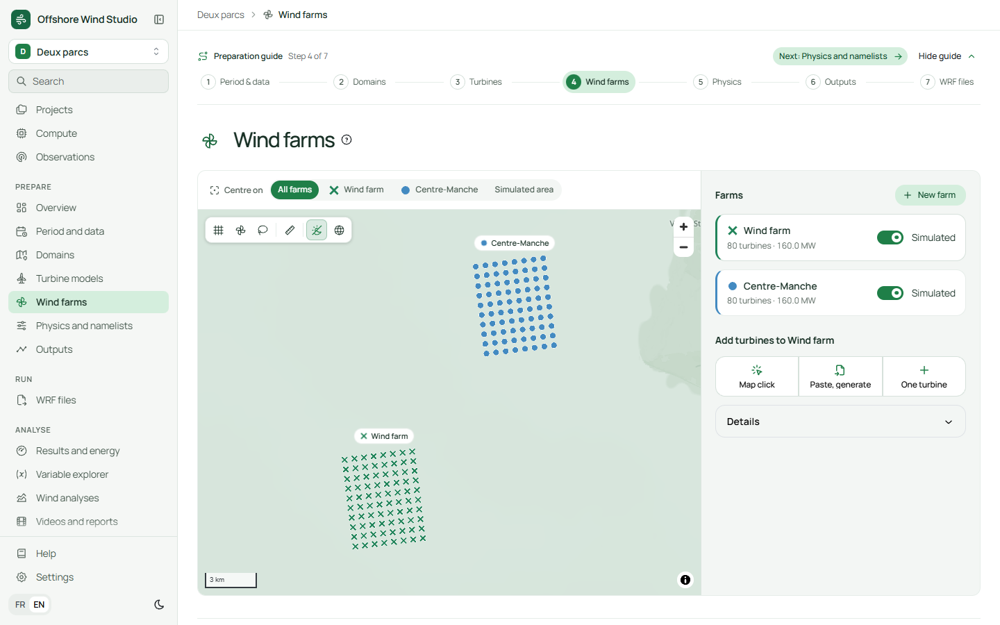
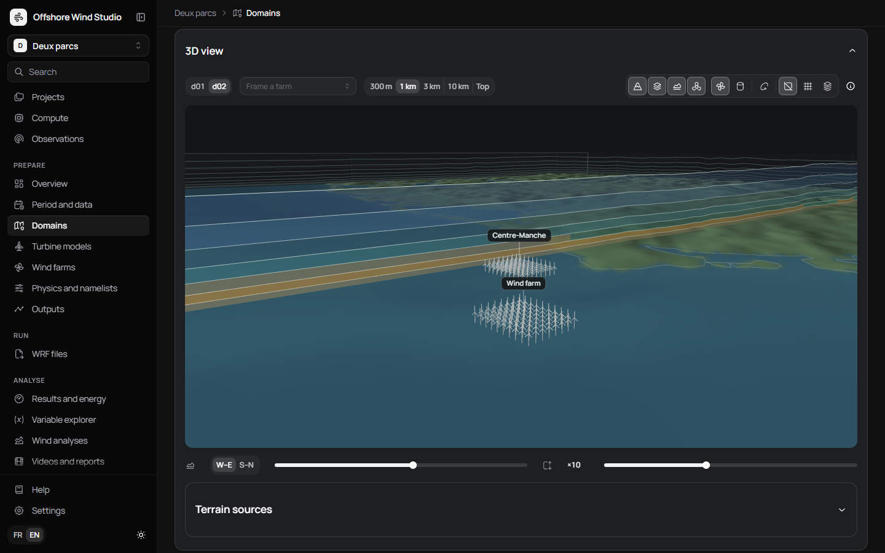

# Offshore Wind Studio

Prepare offshore wind simulations with the official NCAR **WRF** model, wind farm
parameterizations included, then analyse the results, without compiling anything or editing
namelists by hand.



Offshore Wind Studio is a desktop application for Windows and Linux. You describe a study
(period, input data, domains, turbine models, wind farms, physics, outputs); the application
writes every WRF/WPS file and the scripts that run the simulation on a Slurm cluster or a Linux
computer. Once the run is done, you import its outputs and get energy, wake losses, wind
profiles, wind roses, maps, videos and reports.

The interface, the help pages and the exported files are available in English and French.

## Download

Get the latest version from the [Releases page](../../releases/latest):

| System | File |
|---|---|
| Windows 10 / 11 | `OffshoreWindStudio-<version>-setup.exe` |
| Linux, with administrator rights | `offshore-wind-studio_<version>_amd64.deb` |
| Linux, without administrator rights | `OffshoreWindStudio-<version>-linux-setup.run` |

The Linux builds run on Debian 10 and newer (glibc 2.28 or later), Ubuntu, Scibian and most
64-bit distributions. A sample project, `TEST.owstudio.zip`, is attached to each release.

## Install

**Windows.** Run the installer; no administrator account is needed. The installer is not
signed yet, so Windows may show "Windows protected your PC": check the SHA256 checksum given
in the release notes, then choose *More info* > *Run anyway*. Microsoft WebView2 is installed if
it is missing.

**Linux, `.deb`.** Double-click the file and choose *Install*, or run
`sudo apt install ./offshore-wind-studio_<version>_amd64.deb`. Remove it with
`sudo apt remove offshore-wind-studio`.

**Linux, `.run`.** No administrator password is needed:

```sh
sh OffshoreWindStudio-<version>-linux-setup.run
```

The application is installed in your home folder, with menu entries to start and to uninstall
it. Projects (`~/OffshoreWindStudio`) and settings (`~/.config/OffshoreWindStudio`) are kept
when a new version is installed or when the application is removed.

## Getting started

1. Open the application and import the sample project (*Projects* > *Import a project*, then
   choose `TEST.owstudio.zip` as is), or create a new one.
2. Follow the preparation guide at the top of each page: period and data, domains, turbine
   models, wind farms, physics, outputs.
3. In *WRF files*, export the files and copy them to the computer that runs WRF.
4. Run the exported scripts there (`wps/run_wps.sh`, then `wrf/run_wrf.sh`).
5. Back in the application, import the outputs to see the results.

To run WRF on the same computer, *Compute* > *Install an engine* installs WRF 4.8.0 and
WPS 4.7.0: on Windows inside a dedicated WSL Linux, on Linux in a folder of your home.

## Features

- Period split into simulation windows with spin-up, independent or chained through WRF restart
  files, for any length that WRF accepts; outputs grouped by month, week or quarter.
- Nested domains on a map, with their grid cells and a 3D view of the vertical levels, the terrain
  and the turbines.
- Turbine models from a catalogue (power and thrust curves) or your own tables; wind farms placed
  by pasting coordinates, drawing a zone, a regular grid or a GIS file.
- Fitch (2012) and MAV wind farm schemes, physics presets for offshore wind, every namelist option
  with WRF's own documentation.
- Measurement points (tslist) at the turbines or anywhere, and the variables written to the maps.
- Analyses of the outputs: energy, wake losses, power curves rebuilt from WRF's power, wind roses,
  Weibull fits, profiles, stability, comparison with observations, animated maps and PDF reports.



## Building from source

Requirements: Python 3.12, Node.js 20 or later, and on Windows Inno Setup 6 for the installer.

```sh
# Server and core library
cd backend
python -m venv .venv
.venv/Scripts/python -m pip install -e ".[dev,desktop]"    # .venv/bin/python on Linux

# Interface
cd ../frontend
npm ci
npm run build
```

- Windows installer: `powershell -ExecutionPolicy Bypass -File packaging/build.ps1`
  (output in `dist/installer/`).
- Linux installers, built from Windows in a WSL distribution:
  `powershell -ExecutionPolicy Bypass -File packaging/build-linux.ps1` (output in `dist/linux/`;
  see `packaging/linux/setup-env.sh` to prepare the distribution once).
- Tests: `python tools/dev.py tests` runs the server tests inside WSL; on Linux,
  `cd backend && .venv/bin/python -m pytest`.
- Development server with a separate workspace: `python tools/dev.py serve`, then open
  <http://127.0.0.1:8765/>.

```
backend/    Python core library and API server (package owstudio)
frontend/   User interface (React, TypeScript, Mantine, MapLibre)
packaging/  Windows and Linux installers
tools/      Development tools
```

## License

Offshore Wind Studio is released under the [MIT License](LICENSE).

WRF and WPS were developed at NCAR, operated by UCAR, and are in the public domain. WRF® is a
registered trademark of UCAR; this project is not affiliated with or endorsed by NCAR or UCAR.
Manrope © The Manrope Project Authors, under the SIL Open Font License 1.1. Base maps
© OpenStreetMap contributors, served by OpenFreeMap; terrain from the Mapzen Terrain Tiles
(AWS Open Data). ERA5 and ERA5-Land data come from the Copernicus Climate Change Service.
